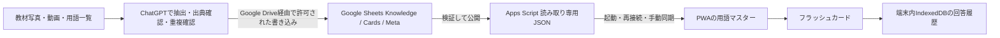

# Google Sheets・ChatGPT連携

## 現行の接続方式：GitHub JSONミラー（Apps Scriptは不要）

2026年11月9日から、次の構成を使用する。以前のApps Scriptによる`initializeMaster`・`publishCatalog`・`/exec`の作業は行わなくてよい。

- **Google Sheets**：[世界史文化史マスター｜追加・修正用データ](https://docs.google.com/spreadsheets/d/1RYkYvk82hqNEIgNGx-xd5B64byQbVaXw087-8F-C78U/edit)。タブは `Knowledge`, `Cards`, `Meta`, `使い方`。
- **公開差分データ**：`public/catalog-delta.json`。2026-11-09時点でv12、`items:[]`, `cards:[]`。
- **アプリ**：v1.4.0で`https://raw.githubusercontent.com/kiyotakalam-collab/-/main/public/catalog-delta.json`を標準同期先として自動取得する。
- **写真登録時**：ChatGPTが写真から用語候補を抽出し、出典・著作権・既存ID・難易度を検証してSheetsの対象行を編集する。次に同内容を公開JSONへ反映する。JSONのカタログ全体versionを1ずつ上げる。途中の未検証行は公開しない。
- **履歴保全**：公開JSONは差分だけ。アプリはIndexedDBでマージし、過去の回答履歴を消さず、公開JSONへも送らない。
- **重要な制限**：Sheetsの直接編集だけではGitHub JSONは自動更新されない。「文化史シートの変更をアプリに反映」とチャットで依頼して更新すること。これはApps Script不要な**ChatGPT経由の同期**であり、Google Sheetsの変更を常時監視するリアルタイム連携ではない。

シート自体は非公開でよい。用語・問題文・画像出典の**公開JSON**は誰でも閲覧可能なので、個人情報、学習履歴、教材の紙面画像や無断転載した原文は入れない。アプリ更新後は、データ管理から同期結果がv12以上になり、既存365項目・506カードが保持されることを確認する。

---

## 旧方式：Apps Script公開手順（現行構成では使用しない）

以下は過去の構成の参考資料。現在の運用では実施不要。

## 2026-11-09：文化史専用の差分マスターを接続する最短手順

現行アプリは **教材v11（365項目・506カード）**。新規作成済みのSheetsは、この既存データをコピーして上書きするのではなく、今後の追加・訂正行だけを持つ **差分マスター** として運用する。3タブの列構成は、`Knowledge` 18列・`Cards` 11列・`Meta` 2列（`使い方`は参考用）。

1. 文化史専用のGoogle SheetをChromeのPC版サイトで開き、`拡張機能 → Apps Script` を選ぶ。
2. `apps-script/Code.gs` の全文をApps Scriptの `コード.gs` に貼り付け、保存する。コードは **2026-11-09現在の更新版**を使うこと（画像カードのID単位の重複判定と差分参照を修正済み）。
3. 関数 `initializeMaster` を一度実行して、Googleによるスプレッドシートへのアクセスを認可する。既に配置したシートの列を上書きせず、対象IDを内部に記録する。
4. 現在 `Meta` は `schemaVersion=1`, `version=11`, `status=draft`。初回は空の差分データでも `publishCatalog` を一度実行して `version=12`, `status=published` にする。現行365項目はクライアント内から消さない。
5. `デプロイ → 新しいデプロイ → ウェブアプリ`。実行するユーザーは **自分**、アクセスできるユーザーは **全員（匿名アクセス可能）**。Googleから認可を求められたら確認する。
6. 表示された **`https://script.google.com/macros/s/.../exec`** をアプリの `データ管理 → 教材の公開JSON URL` に貼り付け、`URLを保存して同期` を押す。成功時に既存項目数と学習履歴が維持されるか確認する。

追加時：このチャットに文化史の写真を送る → 追加候補・出典・重複を照合 → Sheetsの `Knowledge`/`Cards` に差分を書き込み → `Meta` の公開版を更新 → アプリが取得。アプリの画面表示用コードは原則変更不要。

**重要:** Webアプリの公開URLを知る人は登録した用語・問題文を閲覧できる。一方、シート自体は非公開のままでよい。個人情報、学習履歴、未公開教材の原文を入れない。Apps Scriptのクロスオリジン読み取りは端末・Google公開設定で未検証なので、最初の `/exec` URL取得後にPWA実機で確認する。成功したと断定するのはその後。

---

## 現在の状態

アプリの取得処理とApps Scriptのコードを用意しています。対象マスターのGoogle Sheets URL、公開済みApps Script URLは未設定です。**ChatGPT → Sheets → PWA の実接続は未完了・未検証**です。ローカルのスタブ試験が成功しても、実接続済みとは扱いません。

このセッションではGoogle Driveの `batch_update_spreadsheet`、メタデータ・範囲読み取りツールを利用できます。2026年11月9日の権限設定確認では、Google Drive固有の設定は「Allow all actions」でした。これはChatGPT内の操作確認設定です。Google側のOAuth認可範囲・アカウントの接続状態・対象ファイルの編集権限を証明するものではありません。設定は変更されるため、実際に追加するときに改めて対象ファイルを確認します。

## データの流れ

写真からの抽出は誤読を確認してから登録します。教材の文章や画像をそのまま公開する運用にはしません。画像は画像ごとに利用条件を確認し、出典・著作者・ライセンスを登録します。学習履歴はSheetsへ送信しません。

## Sheetsの準備

1. 用語マスター用のGoogle Sheetsを作り、正確なURLを控えます。既存ファイルを使う場合はバックアップを用意します。
2. 「拡張機能 → Apps Script」を開き、`apps-script/Code.gs` を貼り付けます。
3. プロジェクト設定でマニフェストファイルの表示を有効にし、`apps-script/appsscript.json` のV8・UTC・スプレッドシート権限を反映します。
4. エディタから `initializeMaster` を一度実行します。対象ファイルへの認可が必要です。`Knowledge`、`Cards`、`Meta` を作成し、対象ファイルIDをサーバー側のスクリプトプロパティに保存します。既存タブの列が異なる場合は上書きせずエラーにします。
5. `sheets/*.csv` は同じ列のテンプレートです。初期化関数と両方を重ねて取り込む必要はありません。ヘッダーのみのテンプレートに架空の教材内容は含みません。
6. 初期データもSheetsで管理するなら、`npm run sheets:seed` を実行します。`artifacts/sheets-seed/Knowledge.csv` と `Cards.csv` を、初期化済みの同名タブへ「現在のシートを置換」で取り込みます。列順・固定ID・行バージョン・表記・画像メタデータを保った実データを出力します。タブを新設・改名せず、Metaはdraftのまま残して確認後に公開します。新しい名前で同じ初期項目を作り直しません。

CSV取り込み時は「テキストを数値、日付、数式に変換する」をオフにし、ISO日時・JSON・IDをそのまま保ちます。数値列と真偽値列は公開スクリプトが厳密に変換します。

### Knowledgeタブ

列名と順序は `sheets/Knowledge.csv` および `src/types.ts` が正本です。

| 列 | 値 |
| --- | --- |
| `id` | 永続的な英数字ID。初期教材のソクラテスなど、既存項目は必ず書き出した実際のIDを再利用し、改名しない |
| `canonicalName`, `aliases` | 正式名称、別名のJSON配列 |
| `kind` | `person` / `work` / `concept` / `building` |
| `field`, `region`, `era`, `level` | 分野・地域・時代と整数1〜4 |
| `relatedPeople`, `relatedWorks` | 同じKnowledgeタブに存在するIDのJSON配列 |
| `description` | 日本語の補足 |
| `images` | `ImageAsset`オブジェクトのJSON配列 |
| `sources` | `{ "title": "確認した資料名", "url": "実際の出典URL" }` のJSON配列。最低1件。ユーザー提供の紙教材など公開URLがない資料は `url` を省略し、`note` に写真・範囲を記録する |
| `difficultyEvidence` | 掲載・出題根拠。不足する場合は「暫定分類」とその理由 |
| `verification` | `verified` / `provisional` / `needs-review`。事実確認の状態 |
| `updatedAt`, `version`, `deleted` | UTCのISO日時、行バージョン（整数1以上）、`TRUE` / `FALSE` |

配列の空値は空セルではなく `[]` とします。`images` の各要素には `id`, `url`, `sourceUrl`, `author`, `license`, `licenseUrl`, `caption` が必要です。公開画像のURLを確認し、期限付き・認証付きURLを使いません。アプリ同梱画像の `./images/...` はそのアプリの配置先から解決されます。

### Cardsタブ

| 列 | 値 |
| --- | --- |
| `id`, `knowledgeId` | カードの固定ID、既存KnowledgeのID |
| `type` | `achievement-person`, `person-work`, `work-author`, `theory-person`, `image`, `context` |
| `question`, `answer`, `explanation` | 日本語の問題・正答・説明 |
| `imageId`, `fallbackPrompt` | 画像カードは所有するKnowledgeの画像IDと、画像なしで成立する代替問題文が必須。文字カードは空セルでよい |
| `updatedAt`, `version`, `deleted` | Knowledgeと同じ規則 |

1カードで1つの明確な知識を確認します。質問を変えただけの意味のない重複は登録しません。既存カードの説明・難易度を修正するときはIDを維持します。確認する知識そのものを変える場合は旧カードを非表示にし、新規カードIDを発行します。

Lv.1〜3の問題は「『国家』の著者は？」「ストア派を創始した人物は？」のような短い一問一答を基本にします。人物→著作で複数の正答がありうる場合は、一つの作品に絞れる短い補足を加えます。複数の知識・時代・地域などを組み合わせて人物や作品を特定する形式はLv.4だけにします。問う用語の難易度分類と問題文の長さは分けて判断します。

### Metaタブ

`key,value` の2列です。`schemaVersion=1`、カタログ全体の `version`、UTCの `updatedAt`、`status=draft` または `published` を持ちます。現行のアプリ同梱カタログはversion 11です。初回の公開版はversion 12以上にします。既存マスターを使う場合も、その最新カタログとアプリ同梱教材の両方より大きいバージョンで公開します。

## 編集・公開の手順

1. 手作業の編集前にApps Scriptの `beginEdit` を実行します。`status=draft` の間はアプリが同期を受け付けず、端末内の既存データで学習できます。
2. 新規項目は新しい固定IDと `version=1` で追加します。修正は同じIDで行い、変更行の `version` を増やして `updatedAt` を更新します。
3. 名前・別名・関連ID・知識の出典・難易度根拠・画像利用条件を確認します。同一内容・同一バージョンのまま書き換えた行はアプリ側で拒否されます。
4. エディタで `publishCatalog` を実行します。全行を検証してからカタログ全体のバージョンと更新日時を増やし、最後に `published` にします。失敗したらエラーを直して再実行します。
5. `/exec` URLのJSONを確認し、アプリで手動同期します。件数、変更した用語、過去の誤答回数を確認します。

Apps Scriptのロックはスクリプト処理間を調整します。Sheets上の手作業編集や別ツールの書き込みそのものを禁止しません。同時編集を避け、必ずdraftを経由してください。

削除したい用語と対応カードは `deleted=TRUE` にし、各行のバージョン・更新日時も更新します。行を物理削除しただけでは、アプリの既存項目は消えません。履歴は非表示後もバックアップに残ります。削除を取り消す場合も、同じIDで `deleted=FALSE` としてバージョンを増やします。

## 読み取り専用APIを公開

1. Apps Scriptで「デプロイ → 新しいデプロイ → ウェブアプリ」を選びます。
2. 実行ユーザーを自分、アクセスできるユーザーを匿名アクセス可能な設定にします。組織の管理設定で許可されない場合は公開できません。
3. 実際に返された `/exec` URLをアプリの同期URLに保存します。編集権限が必要な `/dev` URLは使いません。
4. サインアウトしたブラウザでJSONを取得し、PWAの公開元からCORS・リダイレクトを含む読み取りを検証します。Content Serviceは `script.googleusercontent.com` にリダイレクトします。アプリは通常のfetchで追従します。
5. 公開設定やScriptコードを変更した場合はデプロイの新バージョンを反映します。Sheetsの行データ変更ごとにコードの再デプロイは不要です。

このURLを知る人は公開カタログを読めます。学習履歴・個人情報・非公開教材のコピー・トークンを同じタブへ入れません。`doPost` は実装していないため、公開URLから書き込む経路はありません。アプリには秘密鍵やOAuthトークンを埋め込みません。

アプリは同期JSONをService Workerへ保存せず、取得結果を検証してからIndexedDBへ適用します。タイムアウト、不正データ、古いバージョン、通信失敗の場合は現在のカタログと履歴を残します。画像のURL変更は再同期後に反映され、取得済み画像はキャッシュの範囲でオフライン表示できます。新しい画像はオンラインで取得が必要です。

CSV単体は関連配列・複数タブ・削除通知・整合した公開版の管理が難しいため、現在のアプリはCatalog JSONを正規の同期形式にします。公開CSVを使う場合は、同じスキーマのJSONに変換するサーバー処理が別途必要です。

## ChatGPTから追加・修正する

使うのは接続された **Google Drive** のGoogle Sheets操作です。PWAがChatGPTへアクセスしたり、写真を自動監視したりする仕組みは実装していません。

実接続時には、対象のSheets URL・タブのメタデータと `sheetId`・列・編集範囲を読み取ってから変更します。ファイルの編集権限と、Sheets書き込みを許すOAuth認可が必要です。Sheets APIのbatchUpdateは `spreadsheets`、`drive.file`、`drive` のいずれかの対応スコープを要求します。実際のコネクター認可は接続設定で確認し、許可されていなければGoogle Driveの再接続・認可を行います。

通常の追加作業は次の一連の操作です。

1. 写真・用語一覧から候補を抽出し、実在する資料と画像ライセンスを確認する。難易度根拠が不足する候補は暫定分類にする。
2. Knowledgeの正式名称・別名・固定IDを検索し、既存項目を再利用する。カードの問題と正答も比較する。
3. `batch_update_spreadsheet` の構造化 `requests` に `updateCells` や `appendCells` を指定し、正確な `sheetId` と行列位置へ書き込む。本文は `userEnteredValue.stringValue` とし、配列はJSON文字列で保存する。数値は `numberValue`、真偽値は `boolValue` でもよい。
4. 複数回に分ける場合は最初にMetaをdraftにする。各変更行のversion・updatedAtを更新し、確認後にApps Scriptの `publishCatalog` を実行する。
5. ChatGPTツールだけで公開する場合は、対象行・全参照の検証と読み戻し後、最後の1回のbatchUpdateでMetaのversion・updatedAt・statusをまとめて更新する。カタログ全体のバージョンは既存値より増やす。Apps Scriptの公開GETも検証を行う。
6. Sheetsを読み戻し、公開JSONとPWAで追加・修正・非表示・履歴維持を確認する。この確認までを成功条件とする。

Google SheetsのbatchUpdate内の要求はまとめて適用されますが、他の共同編集者による変更には注意が必要です。ユーザーが「この用語を登録して」と指示し、対象マスターが特定できる運用を想定します。未設定のファイルを推測して更新しません。

## 実接続の完了条件

- ChatGPTから1項目・1カードを追加し、Sheets読み戻しとPWA同期で確認する。
- 同じ固定IDの説明・画像URL・難易度を修正して反映する。
- 別表記での重複が拒否されることを確認する。
- `deleted=TRUE` と復活を確認する。
- 既存カードで×→○と回答し、全操作後も累積誤答数と回答履歴が残ることを確認する。
- 通信失敗・draft・不正JSON・オフライン復帰時に既存データで学習し、正常な公開版へ再同期できることを確認する。

2026年11月9日に確認した公式資料： [Apps Scriptウェブアプリ](https://developers.google.com/apps-script/guides/web)、[Content Serviceとリダイレクト](https://developers.google.com/apps-script/guides/content)、[Sheets batchUpdateと認可範囲](https://developers.google.com/workspace/sheets/api/reference/rest/v4/spreadsheets/batchUpdate)。
